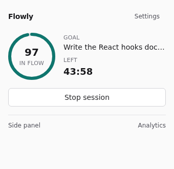
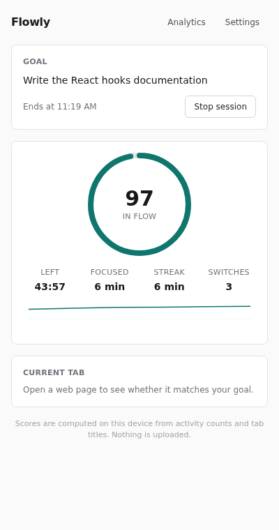
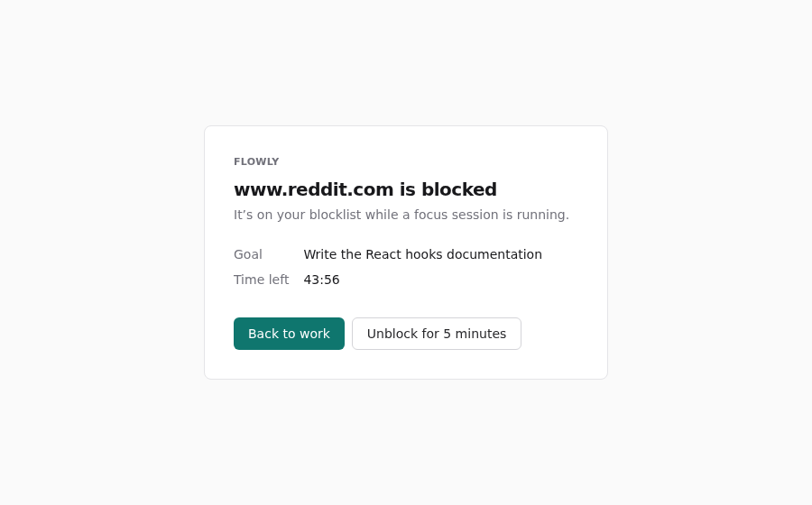

# Flowly — be productive with (optional) AI

Flowly is a Chrome extension (Manifest V3) that helps you stay on one goal. You start a focus
session, Flowly scores your focus on-device, keeps distracting sites out of the way, and learns
from a one-tap "Were you focused?" check-in after each session.

**Privacy first:** scoring, relevance checks and the learning model all run locally. No API key is
bundled, no account is needed, and nothing leaves your browser unless you explicitly turn on the
Gemini tiebreak with your own key. See [PRIVACY.md](PRIVACY.md).

<p>
  
  
  
</p>

## Features

| Surface | What it does |
| --- | --- |
| **Popup** | 3-second glance: focus score, goal, session timer, start/stop. |
| **Side panel** | Main surface: set the goal and length, live score and streak, whether the current tab fits your goal, focus nudges and the post-session check-in. |
| **Blocked page** | Shown instead of a blocked site: your goal, time left, *Unblock for 5 minutes*. |
| **Analytics** | Focus minutes per day (14 days) and a timeline of past sessions with score sparklines. |
| **Options** | Blocklist / allowlist, strict mode, privacy toggles, optional AI provider and key, reset all data. |

How it decides:

- **Focus score (0–100)** — a pure, unit-tested scoring module: activity *counts* (keys, pointer,
  scroll), tab switches per minute, idle state (`chrome.idle`) and the active tab's relevance to the
  goal → normalised features → heuristic score (cold start) blended with a tiny on-device
  **logistic-regression model** → EMA smoothing → status with hysteresis
  (`Distracted / Drifting / Focused / In flow / Idle`).
- **Learning** — after each session you answer *Were you focused?*. The answer is stored locally
  and the model takes one SGD step on that session's average features. After ~10 check-ins the
  personal model fully replaces the heuristic.
- **Distraction check** — rules first (your allowlist, your blocklist, built-in work tools), then
  on-device semantic similarity between your goal and the tab title/URL using
  **transformers.js + `Xenova/all-MiniLM-L6-v2`** in an offscreen document (keyword/TF-IDF
  similarity as fallback). Unclear cases can optionally go to an LLM tiebreak.
- **Blocking** — `declarativeNetRequest` dynamic redirect rules, active only while a session runs.
  *Strict mode* also blocks pages the relevance check marks as off-goal.
- **Optional AI** — Chrome's built-in **Gemini Nano** (Prompt API) when available, or
  **`gemini-2.5-flash-lite`** with *your own* key (stored in `chrome.storage.local`). Structured
  JSON output, validated with Zod, debounced to one call per 20 s, cached per page.

## Setup

Requirements: Node 22 (see `.nvmrc`), pnpm 10, Chrome/Chromium 116+.

```bash
pnpm install
pnpm build          # production build into dist/
pnpm dev            # watch mode with auto-reload
```

### Load unpacked

1. Open `chrome://extensions` and enable **Developer mode**.
2. Click **Load unpacked** and select the `dist/` folder.
3. Pin Flowly, click it, type a goal and press **Start focus session**.

The first relevance check with the on-device model downloads the model weights (~23 MB) from the
Hugging Face Hub once; they are cached by the browser. Turn it off under *Options → Privacy* to use
keyword matching only.

## Testing

```bash
pnpm type-check     # TypeScript across all packages
pnpm lint           # ESLint + Prettier
pnpm test           # Vitest unit tests (packages/core)
pnpm build
pnpm -F @extension/e2e e2e   # Playwright: loads dist/ in headless Chromium
```

The E2E suite starts a local web server (test hostnames are mapped to 127.0.0.1, so no real sites
are contacted) and checks: popup rendering, starting a session from the popup, redirecting a
blocklisted site to the blocked page, *Unblock for 5 minutes*, the flow score reacting to simulated
activity and distraction, options persistence (lists, privacy, AI key), strict-mode auto-blocking,
the focus check-in training the local model, analytics, and reset.

- Use a system Chromium with `CHROME_PATH=/usr/bin/chromium`.
- `FLOWLY_E2E_EMBEDDINGS=1` additionally downloads the embedding model and checks real on-device
  similarity in the offscreen document. `FLOWLY_HF_MIRROR_DIR=/path` serves the model files from a
  local copy instead (for sandboxes without direct Hub access).

CI (`.github/workflows/ci.yml`) runs install → type-check → lint → unit tests → build → E2E on every
push and pull request.

## Project layout

```
chrome-extension/      manifest + background service worker
packages/core/         pure logic: scoring, logistic model, relevance, blocking rules, AI parsing, storage
packages/ui/           shared React components (Button, Card, ScoreDial, charts, hooks)
pages/popup|side-panel|options|analytics|blocked/   extension pages (React 19 + Tailwind)
pages/offscreen/       offscreen document: transformers.js embeddings, Chrome built-in AI
pages/content/         content script: privacy-first activity counter (numbers only)
tests/e2e/             Playwright end-to-end tests
```

More detail in [ARCHITECTURE.md](ARCHITECTURE.md).
